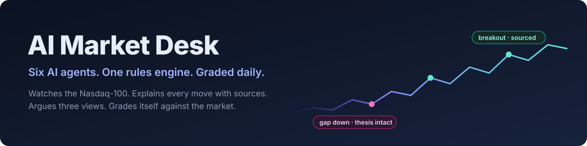

<p align="center"></p>

<p align="center">
  <a href="../../actions/workflows/ci.yml"></a>
  
  
  
  
</p>

**AI Market Desk** watches the Nasdaq-100 every 15 minutes. When a stock moves for a reason, it emails the team: what happened, why (with sources), where the levels are, how two very different strategists would read it, and a plain call: *watch, don't chase, consider adding, consider trimming*. Then it grades every one of those calls against the market.

I built it end to end and ran it every trading day for a live investment team: the rules engine, six AI agents, the email layer, a backtesting lab, a scorecard and a self-check. This repository is a clean, public version on the Nasdaq-100.

<!-- HERO: screenshot of a real alert email (docs/img/alert.png) -->

## What it does, in 30 seconds

- **Free until something happens.** Plain rules scan 100 names every 15 minutes (gaps, breakouts, volume spikes, fast moves, 200-day pullbacks). No AI runs until a rule fires.
- **Explains the move, or says it can't.** A *Tape Reader* agent finds the catalyst in today's news, with links. No source, no claim.
- **Two lenses that are allowed to disagree.** A *Chartist* (levels, trend, DeMark exhaustion, leadership) and a *Strategist* (liquidity, sentiment, breadth) each vote *add / trim / watch*. A fixed rule set, not a model, makes the final Call.
- **You can talk back.** Reply to any alert with a question and the right specialist answers in the same thread.
- **It grades itself.** Every hit, read, vote and email is logged and scored against the market at 5 and 20 days. A daily health check turns every past bug into a permanent test.

## See it work, without keys

```bash
git clone https://github.com/hansonyjy/ai-market-desk && cd ai-market-desk
pip install -e .
desk demo
```

`desk demo` replays a **recorded live session** (real prices, real headlines, real model output) through the same pipeline, completely offline. It needs no API key, calls no model and costs nothing. The emails it would have sent land in `out/demo/mail/`.

<!-- DEMO: terminal capture of `desk demo` (docs/img/demo.png) -->

## How it works

<p align="center"></p>

| Agent | Job | Model |
| --- | --- | --- |
| [Scanner](charters/01-scanner.md) | Plain timing rules on every name, every 15 minutes | none, $0 |
| [Tape Reader](charters/02-tape-reader.md) | Why is it moving right now? Buying, selling or noise, with sources | Sonnet + web search |
| [Chartist lens](charters/04-chartist-lens.md) | Support and resistance from a computed list, trend, exhaustion, leadership | Sonnet, low effort |
| [Strategist lens](charters/05-strategist-lens.md) | Does this move fit or fight today's tape? | Haiku |
| [What they said](charters/07-what-they-said.md) | Real, dated public comments from the strategists the lenses follow | Sonnet + web search, daily |
| [VIP filter](charters/08-vip-filter.md) | Keeps only material breaking news for VIP names | Haiku |
| [Ask the desk](charters/09-ask-desk.md) | Answers replies in-thread, as the right specialist | Sonnet + web search |

Each agent's instructions live in one file in [`charters/`](charters/). The code sends exactly that file, so prompts are reviewed like code.

## What the emails look like

<!-- GALLERY: opening digest, VIP email, Ask the desk reply (docs/img/*.png) -->

## Design principles, and the incident behind each

**1. Code computes every number. Models only explain.**
Prices, levels and percentages come from code. A level the model names must match one on the computed list, and must sit on the correct side of the price. An answer that quotes a price the code didn't compute is thrown away. *(A model once called a level the stock had already cleared "resistance"; that check now exists.)*

**2. No source, no claim.**
Every catalyst needs a link dated today or the last session. Quote pages, homepages and stale stories don't count. If nothing explains a move, the email says so.

**3. The lenses may disagree; the Call may not improvise.**
The Chartist and the Strategist argue. The Call comes from fixed rules, so the same facts always give the same call. It never trims on price alone.

**4. Every rule earns its place.**
The **Rule Lab** replays each price rule over five years against condition-matched random days, clusters errors by month, holds out the latest years, and runs a placebo on random dates. <!-- RULELAB: chart + one-line result on the Nasdaq-100 --> The finding shaped the product: price rules time nothing on their own, so the value has to come from the news read, and the Scorecard measures exactly that.

**5. Every bug becomes a check.**
`audit.py` runs after the close and emails one line: *all clear* or *N fail, M warn*. Each check is a problem the desk actually had: a repeated VIP story, an alert with no source, a cap exhausted before noon, a security renamed in the Universe.

## Engineering notes

- **Cost control.** Rules are free. AI runs only on hits, in small batches, under a hard daily call cap, and each run logs its cost per agent. A full live day costs about $1.
- **Budgets you can see.** Per-day caps on short-term, long-term and VIP emails; VIP news is uncapped for three trading days after that name reports.
- **Time limits.** The Chartist runs at low reasoning effort with a token budget that scales with the batch, plus one retry. A 9-alert batch once spent 3.7 minutes thinking and hit the job's time limit.
- **Data hygiene.** Stale bars are dropped against the exchange calendar; 200-day signals are switched off for 200 trading days after a spin-off, when the history describes a different company.
- **Record and replay.** `desk record` hooks the four boundaries (market data, HTTP, the model client, the clock) and nothing else. `desk demo` replays them, so the code that runs in the demo is the code that runs live. A test proves the replay reproduces the recording's emails exactly, with the network blocked.

## Run it live, with your own keys

The repo ships **no keys** and **nothing runs on a schedule**.

```bash
cp .env.example .env      # add ANTHROPIC_API_KEY and FINNHUB_KEY
desk scan --force         # one pass now; emails go to out/mail/
desk ask "NVDA: where is support if this keeps falling?"
```

Set Gmail settings in `.env` to send real email, or `SHEET_ID` to use a Google Sheet instead of local files. Every threshold, cap and model is a setting (see `.env.example`).

## Repository map

```
desk/            the package: scanner, agents (ai.py), levels, macro, mailer, inbox, audit, rulelab, replay, cli
charters/        one prompt file per agent
desk/config/     universe (Nasdaq-100), sector benchmarks, VIP keywords, source rules
tests/           500 offline checks, including an end-to-end record/replay test
demo/fixtures/   the recorded session that `desk demo` replays
```

## About

Built by **Hanson Yang**: MSBA, UCLA Anderson (Dec 2026); B.Com Finance, UBC. I work where data science meets markets.
<!-- LINKS: LinkedIn / portfolio -->

*Research tool, not investment advice. Simulated lens views apply public frameworks; they are not anyone's real opinion. All rights reserved: see [LICENSE](LICENSE).*
