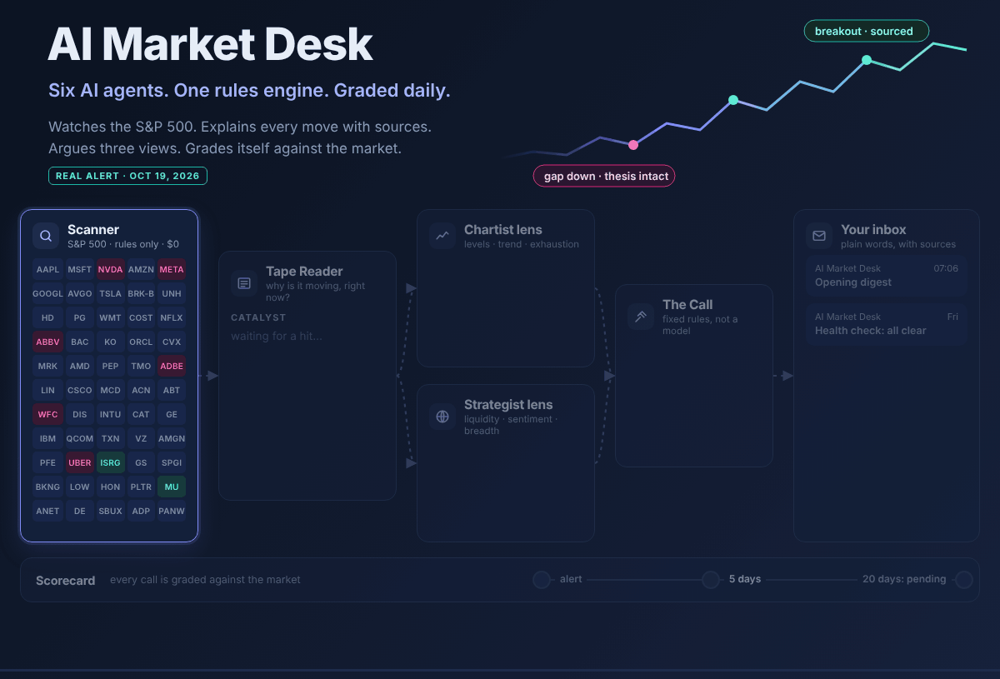
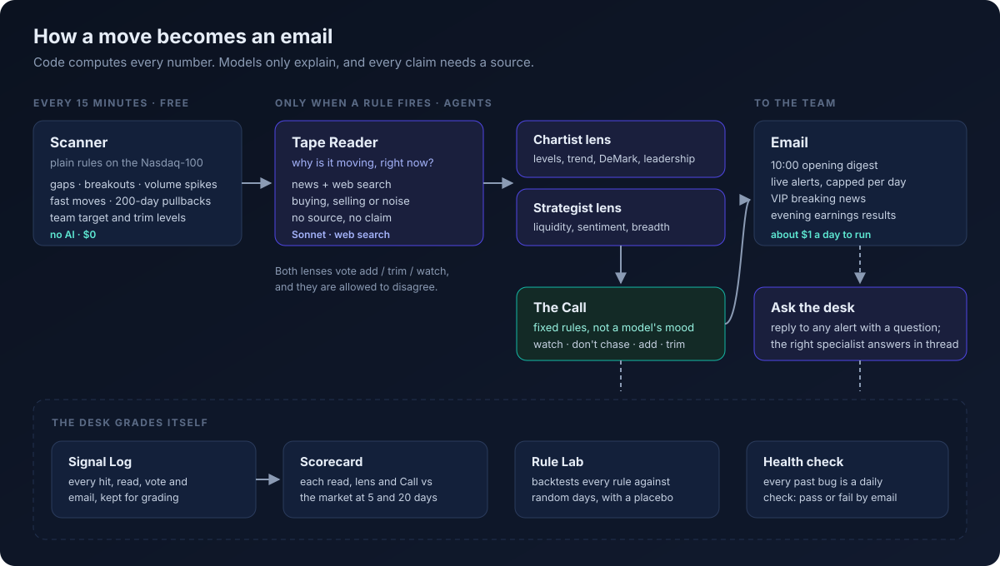

<p align="center"></p>

<p align="center">
  <a href="../../actions/workflows/ci.yml"></a>
  
  
  
  
</p>

**You can't watch 500 stocks at once. AI Market Desk can.**

Every 15 minutes it scans the S&P 500, or your own portfolio and watchlist, and stays quiet until a move has a reason. Then it emails you: what moved, why (with sources), where support and resistance are, how a chartist and a macro strategist would each read it, and one plain call: *watch, don't chase, consider adding, consider trimming*. Set your own entry and trim levels and it watches those too. Then it grades every call it made against the market.

I designed and built it end to end, as a product and as a system: what an investor needs to see in a 30-second email, the rules engine and six AI agents behind it, and the scorecard that keeps it honest. I build with Claude Code as a pair programmer, and the history shows how: small changes, each with its reason and its tests.

## What lands in your inbox

- **The opening digest, at 07:00 PT.** The open's gaps and breakouts, each with its catalyst, grouped by theme, under one line on the market backdrop.
- **Live alerts.** A name breaks out, gaps or moves fast on volume, and the news explains why. Capped per day, so it never floods you.
- **Your levels.** A holding reaches your trim level, or a watchlist name reaches your entry: always emailed, with the news that moved it there, or *No news found*.
- **VIP breaking news.** For the few names you follow most closely: material headlines every 15 minutes, with opinion pieces and recycled stories filtered out.
- **Answers.** Reply to any alert ("where is support if this keeps falling?") and the right specialist answers in the same thread.

## How it works

<p align="center"></p>

- **Free until something happens.** Plain rules scan every name every 15 minutes: gaps, breakouts, volume spikes, fast moves, 200-day pullbacks, your levels. No AI runs until a rule fires.
- **Only the strongest hits get read.** On 500 names a busy open can fire dozens of rules. Each scan ranks its hits by volume, size of move and setup, and only the top 8 go to the agents. The rest still go in the Signal Log, tagged `triage_cut`.
- **Explains the move, or says it can't.** A *Tape Reader* agent finds the catalyst in today's news, with links. No source, no claim.
- **Two lenses that are allowed to disagree.** A *Chartist* (levels, trend, DeMark exhaustion, leadership) and a *Strategist* (liquidity, sentiment, breadth) each vote *add / trim / watch*. A fixed rule set, not a model, makes the final Call.
- **It grades itself.** Every hit, read, vote and email is logged and scored against the market at 5 and 20 days.

| Agent | Job | Model |
| --- | --- | --- |
| [Scanner](charters/01-scanner.md) | Plain timing rules on every name, every 15 minutes | none, $0 |
| [Tape Reader](charters/02-tape-reader.md) | Why is it moving right now? Buying, selling or noise, with sources | Sonnet + web search |
| [Chartist lens](charters/04-chartist-lens.md) | Support and resistance from a computed list, trend, exhaustion, leadership | Sonnet, low effort |
| [Strategist lens](charters/05-strategist-lens.md) | Does this move fit or fight today's tape? | Haiku |
| [What they said](charters/07-what-they-said.md) | Real, dated public comments from the strategists the lenses follow | Sonnet + web search, daily |
| [VIP filter](charters/08-vip-filter.md) | Keeps only material breaking news for VIP names | Haiku |
| [Ask the desk](charters/09-ask-desk.md) | Answers replies in-thread, as the right specialist | Sonnet + web search |

Each agent's instructions live in one file in [`charters/`](charters/). The code sends exactly that file, so prompts are reviewed like code.

## Make it yours

The S&P 500 is only the default. The stock list is one CSV file, or one tab in a Google Sheet. Swap in what you own and what you are waiting to buy:

```csv
Ticker,Name,Status,Priority,Target entry level,Trim level,Theme
NVDA,Nvidia,Holding,Normal,,250,AI chips
TSLA,Tesla,Holding,VIP,,,EV / robotics
COST,Costco,Watch,Normal,850,,Staples
```

*(The levels above are placeholders. Use your own.)*

| Column | What it changes |
| --- | --- |
| **Status** | `Holding` or `Watch`. Only a holding can ever get *consider trimming*. |
| **Priority** | `VIP` adds the 15-minute breaking-news check. Keywords per name live in [`vip_config.json`](desk/config/vip_config.json). |
| **Target entry level** | At or below it, you get an email. A quiet drift to your price is *consider adding*. Bad news, or a sharp drop with no news found, holds the Call back from adding. |
| **Trim level** | At or above it, on a holding, you get *consider trimming*. |
| **Theme** | Groups your names in the opening digest. |

Your levels are your instructions, so they skip the rules that keep other alerts quiet. They are never cut by triage, never stopped by a daily cap, and they are emailed even when no news explains the move. The email says *No news found* rather than guessing a reason.

Point the desk at your list with `UNIVERSE_CSV=my_portfolio.csv` (a file, or the CSV link of a published Google Sheet), or set `SHEET_ID` (with a Google service account) to edit the list in a spreadsheet and keep the log there too. For a closer peer comparison, map a name to its sector ETF in [`benchmarks.json`](desk/config/benchmarks.json).

## See it work, without keys

```bash
git clone https://github.com/hansonyjy/ai-market-desk && cd ai-market-desk
pip install -e .
desk demo
```

`desk demo` replays a **recorded live session** (real prices, real headlines, real model output) through the same pipeline, completely offline. It needs no API key, calls no model and costs nothing. The emails it would have sent land in `out/demo/mail/`.

<!-- DEMO: terminal capture of `desk demo` (docs/img/demo.png) -->

## What the emails look like

<!-- GALLERY: opening digest, VIP email, Ask the desk reply (docs/img/*.png) -->

## Product decisions

- **Email, not a dashboard.** Investors live in their inbox and won't open another app at 9:45. Every alert reads top to bottom in 30 seconds: what moved, why, the levels, two views, the call.
- **Four calls, in plain words.** No price targets and no scores to decode. *Watch* · *Watch, don't chase* · *Consider adding* · *Consider trimming*. The words carry the market judgment: a breakout on news is a reason to watch, not to chase.
- **Silence is a feature.** Daily caps for each kind of email, one opening digest instead of ten pings at the open, and triage. An alert that arrives rarely is an alert that gets read.
- **Your instructions beat the desk's rules.** "No source, no claim" keeps the desk from inventing reasons, but a level you set is the news. It is always emailed, and when nothing explains the move the email says so instead of staying silent.
- **Never trim on a bad day alone.** A sector-wide or market-wide selloff is not a reason to sell a holding. Only company-specific news with high confidence, or your own trim level, can lead to *consider trimming*.
- **Two views, clearly labeled.** Price-led and macro-led investors read the same move differently. Showing both, marked as simulated, is more useful than one blended opinion.
- **Trust is earned by grading.** The desk scores its own calls at 5 and 20 days, so you can see whether it is worth listening to.

## Design principles, and the incident behind each

**1. Code computes every number. Models only explain.**
Prices, levels and percentages come from code. A level the model names must match one on the computed list, and must sit on the correct side of the price. An answer that quotes a price the code didn't compute is thrown away. *(A model once called a level the stock had already cleared "resistance"; that check now exists.)*

**2. No source, no claim.**
Every catalyst needs a link dated today or the last session. Quote pages, homepages and stale stories don't count. If nothing explains a move, the email says so.

**3. The lenses may disagree; the Call may not improvise.**
The Chartist and the Strategist argue. The Call comes from fixed rules, so the same facts always give the same call. It never trims on price alone.

**4. Every rule earns its place.**
The **Rule Lab** replays each price rule over five years against condition-matched random days, clusters errors by month, holds out the latest years, and runs a placebo on random dates. <!-- RULELAB: chart + one-line result on the S&P 500 --> The finding shaped the product: price rules time nothing on their own, so the value has to come from the news read, and the Scorecard measures exactly that.

**5. Every bug becomes a check.**
`audit.py` runs after the close and emails one line: *all clear* or *N fail, M warn*. Each check is a problem the desk actually had: a repeated VIP story, an alert with no source, a cap exhausted before noon, a security renamed in the Universe.

## Engineering notes

- **Cost control.** Rules are free. AI runs only on the top-ranked hits, in small batches, under a hard daily call cap, and each run logs its cost per agent. Watching 500 names costs about the same as 100: about $1 a day.
- **Triage under a budget.** Hits are scored in plain arithmetic (volume, move, LONG setup, new story) and read strongest first, so if the budget runs out it is the weakest names that go unread. The run log shows every score and every cut.
- **Built for 500 names.** Earnings dates come from one calendar call per week instead of one call per name (500 calls at the free tier's 60 a minute would take over 9 minutes). The universe is rebuilt from the public index list by `scripts/build_universe.py`, with GICS sectors mapped to sector ETFs.
- **Budgets you can see.** Per-day caps on short-term, long-term and VIP emails; VIP news is uncapped for three trading days after that name reports.
- **Time limits.** The Chartist runs at low reasoning effort with a token budget that scales with the batch, plus one retry. A 9-alert batch once spent 3.7 minutes thinking and hit the job's time limit.
- **Data hygiene.** Stale bars are dropped against the exchange calendar; 200-day signals are switched off for 200 trading days after a spin-off, when the history describes a different company.
- **Record and replay.** `desk record` hooks the four boundaries (market data, HTTP, the model client, the clock) and nothing else. `desk demo` replays them, so the code that runs in the demo is the code that runs live. A test proves the replay reproduces the recording's emails exactly, with the network blocked.

## Run it live, with your own keys

The repo ships **no keys** and **nothing runs on a schedule**.

```bash
cp .env.example .env      # add ANTHROPIC_API_KEY and FINNHUB_KEY
desk scan --force         # one pass now; emails go to out/mail/
desk ask "NVDA: where is support if this keeps falling?"
```

Set Gmail settings in `.env` to send real email, or `SHEET_ID` to use a Google Sheet instead of local files. Every threshold, cap and model is a setting (see `.env.example`).

## Repository map

```
desk/            the package: scanner, agents (ai.py), levels, macro, mailer, inbox, audit, rulelab, replay, cli
charters/        one prompt file per agent
desk/config/     universe (S&P 500), sector benchmarks, VIP keywords, source rules
scripts/         rebuild the universe when the index changes
tests/           500 offline checks, including an end-to-end record/replay test
demo/fixtures/   the recorded session that `desk demo` replays
```

## About

Built by **Hanson Yang**: MSBA, UCLA Anderson (Dec 2026); B.Com Finance, UBC. I work where data science meets markets.
<!-- LINKS: LinkedIn / portfolio -->

*Research tool, not investment advice. Simulated lens views apply public frameworks; they are not anyone's real opinion. All rights reserved: see [LICENSE](LICENSE).*
